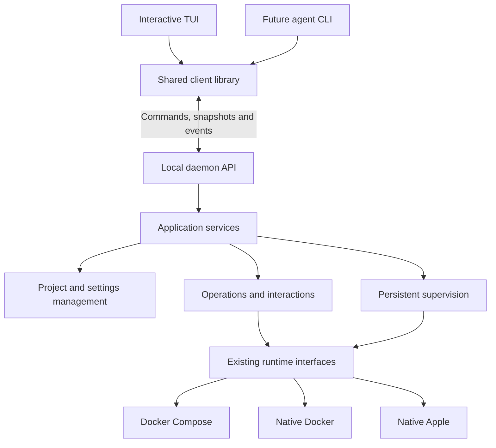

# Persistent server and frontends plan

Historical design retained for reference. Native Docker and Apple execution have been removed. See the [current transition guide](../compose-transition.md).

Status: implemented in the local package. See [architecture](architecture.md) and
[daemon operation](daemon.md) for the resulting structure and behaviour. Automated
verification covers isolated daemon, recovery and terminal workflows; real-engine
and macOS login/reboot acceptance remain manual release checks. The text below
records the design that guided implementation. Split chs-dev into a persistent local daemon and frontends
that share an application API. Preserve the TUI's interactive workflows while
allowing operations and Apple supervision to continue after it closes. Prepare
the boundary for a future agent CLI; implementing that CLI is a later task.

The following requirements are confirmed:

- One daemon runs under the current user's account and manages one active checkout.
- The daemon starts when a frontend connects and at macOS login.
- Environment startup remains explicit after reboot or login.
- Switching checkouts stops the existing environment before activating the next.
- Connections are local to the machine. Multiple frontends may connect and control
  the active environment, with the server coordinating conflicting requests.
- Either frontend can initiate interactive login.
- Docker Compose, native Docker and native Apple remain supported.
- Service installation targets macOS. A Linux service is outside this plan.

The following sections retain the original design and milestone boundaries.

Keep one TypeScript package with separate TUI and daemon entry points initially.
Reuse the existing domain rules, preparation, orchestration and runtime adapters.
Introduce application, protocol, server and client modules without reorganising
unrelated code.

| Component               | Responsibility                                                                                            |
| ----------------------- | --------------------------------------------------------------------------------------------------------- |
| TUI                     | Navigation, drafts, selection, rendering, keyboard handling, local animations and displaying interactions |
| Shared client           | Connection discovery, commands, subscriptions, reconnecting and attaching to interactions                 |
| Application services    | Configuration changes, environment actions, operation coordination, authentication and project switching  |
| Daemon                  | API, process lifetime, scheduling, persisted state and recovery                                           |
| Runtime implementations | Compose, Docker and Apple execution through the existing interfaces                                       |

The current [live hook](../src/tui/hooks/use-live.ts) creates, polls and closes a
[LiveController](../src/application/live-controller.ts). Move that ownership to the
daemon. The controller is reusable, but its scheduling, in-memory intent and
shutdown behaviour need to be separated from frontend lifetime.

Expose application services for project discovery and cloning, settings,
configuration edits, environment actions, service reloads, containers, logs,
authentication and SSH setup. UI components receive snapshots and command
interfaces instead of concrete controllers or runtime adapters. The server owns
validation and mutations; frontends retain presentation and unsaved drafts.

Replace process-wide settings, credentials and logging dependencies with explicit
session context. Resolve tool locations and environment requirements independently
of a frontend's shell. Preserve existing configuration files and their comments
during migration. Keep the legacy CLI's settings separate.

Connecting a frontend with different project or environment overrides must not
silently reconfigure the shared session. Surface the mismatch and use the same
explicit settings or project-switch action as the TUI. Keep settings provenance
visible, and define which overrides belong to daemon startup, the project session
or a particular request before migrating their callers.

Use versioned HTTP/JSON over a private Unix socket, with server-sent events for
updates. Node provides local IPC through Unix sockets. Use a short socket path in
a private user directory, restrictive permissions, runtime request validation and
bounded request sizes. See the [Node IPC documentation](https://nodejs.org/docs/latest-v22.x/api/net.html#ipc-support).

| Contract         | Required information                                                                                                                        |
| ---------------- | ------------------------------------------------------------------------------------------------------------------------------------------- |
| Session snapshot | Daemon identity, active checkout, session generation, runtime, configuration revision, capabilities, state freshness and current operations |
| Command          | Action, target, checkout identity, session generation, request ID and relevant expected revision                                            |
| Operation        | Stable ID, originating client, state, progress, timestamps, result and cancellation status                                                  |
| Event            | Sequence cursor, project/session identity and typed payload                                                                                 |
| Interaction      | Owning operation, kind, required input, claim state and resolution status                                                                   |

Long operations return an operation ID promptly. Clients can inspect or follow
that operation independently of the request connection. Dropping a connection or
closing the TUI does not cancel accepted work; cancellation is an explicit command.

Persist command acceptance and request deduplication before starting its side
effects. Reusing a request ID with the same payload returns the original operation;
using it with different contents fails. A crash can still leave an external
command's outcome uncertain. Inspect actual state during recovery instead of
claiming exactly-once execution or blindly replaying the command.

Deliver an initial snapshot and subsequent events without a subscription gap.
Retain bounded event history for reconnection. If the cursor is unavailable or
belongs to another daemon incarnation, send a new snapshot. Keep container log
output and private interaction traffic separate from lifecycle events. Slow
subscribers must not stall operations or cause unbounded memory growth.

Serialize conflicting mutations within the active session. Configuration saves
use expected revisions, can occur while work is running, and preserve the current
behaviour of coalescing pending auto-apply changes. An active operation keeps its
immutable input. Explicit conflicting actions return an actionable busy result
with the active operation ID, unless the command has defined queueing behaviour.
Stop clears queued applies, prevents supervisor restarts, cancels or drains
conflicting work and then stops the environment.

Requests identify the checkout and session generation so that a stale frontend
cannot affect a newly selected project. Container actions additionally verify the
selected engine, ID and incarnation. Preserve the distinction between an exact
container action and an environment operation. The All containers view continues
to permit its existing controls, with mutations coordinated against the active
environment when they affect its containers.

Project switching is one observable operation with explicit stages:

1. Validate the destination checkout before disrupting the active environment.
2. Persist the switch intent, prevent new mutations and quiesce existing work and
   lifecycle supervision for the old checkout.
3. Run the existing environment Stop workflow, which stops and removes owned
   containers while retaining data volumes. This also releases exact service
   names for the next checkout. Do not remove foreign containers or volumes.
4. Verify Stop completed. On failure or cancellation, keep the old checkout active
   and report the remaining containers; do not activate the destination.
5. Commit the new active checkout and increment the session generation. Discard old
   queued commands, confirmations and interaction continuations, then publish a
   fresh snapshot to every frontend.
6. Show the new checkout's configuration and status. Starting its environment is a
   separate explicit action.

If activation fails after the old environment has stopped, report that partial
outcome and retain the old selection where possible. Do not restart it implicitly.
Journal the switch stages so a daemon crash cannot create two active supervisors.
Runtime or orchestrator changes use the same stop-before-reconfigure boundary;
they do not migrate data between engines.

The existing Stop semantics are implemented by
[LiveController.stop](../src/application/live-controller.ts). Retaining those semantics
avoids a new policy for deleting containers during a switch. Persistent data stays
with its original checkout and backend.

Preserve the current TUI screens, shortcuts, staged edits, filtering, scrolling,
service-to-container navigation and terminal handover. Animate spinners locally.
The daemon supplies the current action, affected service, elapsed-time inputs,
wait reason and progress output. Show disconnected or stale state explicitly and
retain local navigation when reconnecting.

An interaction manager coordinates AWS and registry login, SSH setup, clone
prompts and plan confirmations. Deduplicate login attempts by credential context.
Either frontend can initiate login; one frontend claims input ownership for each
interaction. Other clients can see its safe status without receiving private input.

Prefer structured prompts and browser-login information. Where a command needs a
terminal, run it in a daemon-owned terminal session with attachment, resizing and
interrupt support. Define disconnect behaviour per interaction: a browser login
can finish independently, while an abandoned terminal prompt must release its
claim and have a bounded recovery or cancellation path.

The future CLI can attach to these interactions when it has a terminal, expose a
login URL where appropriate, or return structured interaction requirements. It
does not need the TUI to initiate login. Keep passwords and private terminal
traffic out of API event history and diagnostics. Continue using the existing
credential stores and explicitly managed SSH secret files.

Authentication completion must recheck the active session, operation intent and
configuration. It must never resume work cancelled by Stop or project switching.
Bind confirmations to the plan and revision they approve; changes require a fresh
preview. Frontends translate structured errors and suggested actions into suitable
messages and shortcuts.

Move monitoring to a scheduler owned by the daemon. The current controller skips
polling while busy, so transferring that timer alone would still delay checks
during long builds. Separate observation and health probes from lifecycle
mutations. Bound probe concurrency and timeouts, keep checking unaffected
containers during operations, and discard results for replaced containers.

Send supervisor restart requests through the same mutation coordination as user
actions. Preserve manual stops, job completion rules and restart backoff. Share
health observations with readiness checks to avoid duplicate probes. Continue
runtime-specific discovery and routing updates after frontends detach. Docker
retains its engine-provided health and restart handling; the Apple adapter keeps
the supervision chs-dev provides.

Treat daemon startup and environment startup as separate state transitions:

| Event                                       | Planned behaviour                                                                                                                            |
| ------------------------------------------- | -------------------------------------------------------------------------------------------------------------------------------------------- |
| Frontend closes                             | Operations, authorised supervision and monitoring continue                                                                                   |
| Another frontend connects                   | Attach to the current session without applying or starting anything                                                                          |
| Daemon restarts during the same macOS login | Reinspect actual state and resume previously authorised supervision; recover interrupted work explicitly                                     |
| Mac reboots or the user begins a new login  | Start the daemon and load the selected checkout; require Start before chs-dev starts or restarts stopped containers or applies configuration |
| Environment Stop succeeds                   | Persist stopped intent and suppress auto-apply and supervisor restarts until an explicit start action                                        |
| Checkout switches                           | Stop the previous environment, select the destination and await Start                                                                        |

Record a host login-session identity separately from the daemon process identity.
A previous session's running intent must not activate Apple restart policies at
login. If that identity cannot be established reliably, leave environment startup
explicit. Containers already running may be inspected and health-checked; runtime
behaviour outside chs-dev is observed without silently changing Docker policies.
Monitoring cannot run while the host is asleep; refresh state on wake before
scheduling recovery actions.

Use the existing private state directories behind a versioned state-store
interface. An initial implementation can use atomic JSON checkpoints for intent,
operations and deduplication, with bounded append-only progress history. Include
the active checkout, runtime, session identity, manual stops, pending and blocked
operations, configuration revisions and restart backoff. Keep prepared artifacts
and existing runtime metadata compatible with their current consumers.

Recovery reconciles this state with actual containers. Mark interrupted commands
accurately, account for child processes that may have survived the daemon, and
avoid replaying builds or successful initialization jobs automatically. Persist
only redacted diagnostics, cap retention and distinguish stale cached health from
a fresh result. Replace the current bare project lock with ownership metadata and
verified stale-lock recovery. A failed connection or PID check alone must not
justify deleting another process's lock or socket.

Deliver the change in these milestones:

1. **Extract the application core.** Introduce application interfaces and an
   embedded client adapter while keeping the current process arrangement. Move
   coordination out of React hooks and replace concrete controller dependencies
   in screens. Inject settings, environment, credentials and logging. Completion:
   existing TUI workflows still pass, and the application core can run without Ink
   or a terminal.

2. **Add the local daemon and shared client.** Implement the server entry point,
   socket discovery, protocol validation, version negotiation, commands, operation
   IDs and subscriptions. Keep single ownership of each checkout during the
   transition. Completion: two test clients see the same state, disconnecting one
   does not cancel accepted work, and retried requests do not duplicate operations.

3. **Make supervision durable.** Move scheduling into the daemon, separate probes
   from mutations, persist intent and operation records, and implement restart
   recovery and login-session startup gating. Completion: checks continue with no
   clients, builds do not starve unrelated probes, manual stops survive recovery,
   and a new login performs no automatic environment start or apply.

4. **Support interactive workflows.** Implement interaction claims, authentication
   recovery, SSH input, revision-bound confirmations and terminal attachment where
   required. Completion: login works through a client, concurrent clients do not
   duplicate it, Ctrl+C cancels the intended interaction, and secrets remain absent
   from history and diagnostics.

5. **Convert the complete TUI.** Route every tab and modal through the client,
   preserve local UI state, add reconnection and conflict handling, and implement
   the stop-and-switch sequence. Completion: existing workflows work through the
   daemon, closing and reopening the TUI preserves operations, and stale requests
   cannot affect another checkout. Failed Stop prevents a switch.

6. **Package macOS startup and enable daemon mode.** Add user service installation,
   startup, status, restart and removal; stable executable paths; bounded logs; and
   compatible upgrade behaviour. Completion: login starts one daemon, frontend
   launches reuse it, crash restart works, environment Start remains explicit, and
   incompatible client upgrades do not silently terminate active work.

Use a per-user macOS LaunchAgent for login startup and crash supervision. The
installer and frontend connection path must use the same service identity so they
cannot start competing daemons. Separate service shutdown from environment Stop,
and make intentional service shutdown cooperate with launchd rather than causing
an immediate restart. Keep a foreground daemon mode for development. See
[Apple's launchd documentation](https://developer.apple.com/library/archive/documentation/MacOSX/Conceptual/BPSystemStartup/Chapters/CreatingLaunchdJobs.html).

Validate each milestone with focused tests, including protocol contract tests,
temporary-state recovery tests, two-client races, terminal interaction tests and
runtime integration scenarios. Cover Compose, native Docker and native Apple;
lost responses; reconnect gaps; slow clients; daemon crashes; blocked login;
stale container identities; failed project switches; and retained data after
switching away and back. Exercise a new login separately from a daemon restart
within the same login.

Keep daemon mode opt-in until the complete TUI workflow passes. Embedded and
daemon modes must never supervise the same checkout simultaneously. External
tools remain possible sources of configuration and container drift; detect them
without claiming that the daemon's client coordination locks those tools out.

The acceptance scenario is: start an environment from the TUI, close every
frontend, and reopen it to observe the same operations and continuing supervision.
Then switch checkouts and verify the old environment is stopped before selection
changes. Finally, begin a new macOS login and verify that the daemon starts while
the selected environment waits for an explicit Start.

The future agent CLI reuses the same API, errors, operations and interaction
contracts. Its command design and implementation remain a separate deliverable.
