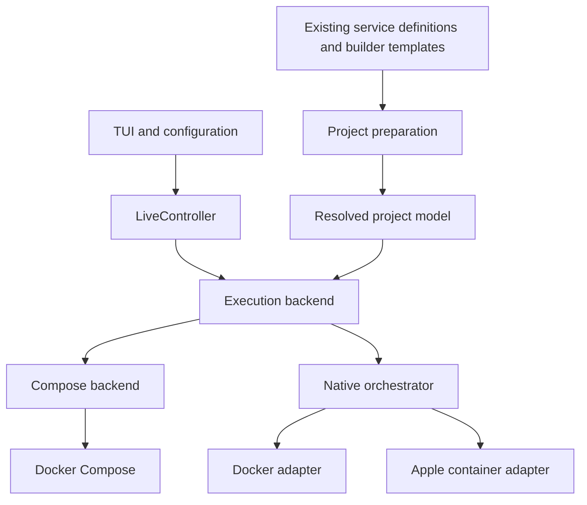

# Native orchestration and Apple container support

Status: native Docker and the staged Apple runtime are available for opt-in testing.
See [implementation, compatibility limits and validation](native-orchestration.md).
The sections below preserve the original architecture and rollout plan.

## Direction

Deliver two major milestones:

1. Implement our own orchestration layer and prove it against Docker.
2. Add Apple container support using the same orchestration layer.

Docker Compose remains a supported execution path throughout. Separate orchestration
from the container runtime: currently `runtime: docker` effectively means Docker
managed through Compose, but these are different choices.

The existing code provides a useful foundation. `LiveController` handles user
intent, operation sequencing, cancellation and locking, while `RuntimeStrategy`
provides a backend boundary. However, `PreparedProject` exposes Compose files and
container discovery depends on Compose labels. These are the main boundaries to
improve.

## High-level architecture



| Component           | Responsibility                                                                                      |
| ------------------- | --------------------------------------------------------------------------------------------------- |
| Project preparation | Resolve enabled services, development mode, environment, builders and resources into a typed model. |
| `LiveController`    | Keep its existing role: user actions, auto-apply, operation locking, cancellation and progress.     |
| Compose backend     | Execute through Compose, retaining compatibility with existing workflows.                           |
| Native orchestrator | Compare desired and actual state, plan changes, order dependencies and execute the plan.            |
| Runtime adapters    | Manage individual containers, images, networks, volumes, logs and execution inside containers.      |

Compose remains a backend alongside the native orchestrator. It should not be
squeezed into the same low-level interface as Docker and Apple.

Configuration could distinguish:

```yaml
orchestrator: compose # compose | native
runtime: docker      # docker | apple
```

Initially, only `compose + docker` and `native + docker` would be valid. Existing
settings retain their current meaning. The UI could present three understandable
presets once Apple is available. Runtime selection remains a restart-only setting.

## Lower-level boundaries

### Typed project model

Define services, dependency conditions, image/build requirements, environment,
mounts, ports, networks, health checks and resources. Distinguish long-running
services from one-shot jobs and retain builder-to-service ownership. Include source
locations for useful errors.

The existing YAML remains the source of truth. We do not need a second
configuration format or an implementation of the entire Compose specification.

### Pure planner

Given the resolved model and a runtime snapshot, produce explicit operations such
as pull, build, create, start, wait, stop and remove. The same plan drives preview
and execution.

Use our own ownership labels and per-service configuration fingerprints.
Reapplying unchanged configuration should do nothing; changing one service should
recreate only what needs updating. Fingerprints need to account for resolved
configuration and relevant build inputs without exposing credentials.

### Executor

Run independent operations with bounded concurrency, respect cancellation and
report failures against the affected service. Reinspect after interrupted
operations so retries converge from actual state.

Implement dependency semantics, not just startup order: started, healthy and
completed successfully mean different things. Dependency-triggered restarts also
differ from container restart policies. These distinctions already matter in the
project's builders and initialization jobs. See the
[Docker service reference](https://docs.docker.com/reference/compose-file/services/).

### Runtime interfaces and capabilities

Container lifecycle, image preparation, networking, storage and registry
authentication should have separate contracts. Start with CLI adapters using
structured output; keep command construction out of the orchestrator.

Validate the selected project against the chosen backend before making changes.
Unsupported features should identify the service and field involved rather than
being silently ignored.

### State and ownership

Keep state in the existing project state directory, with a small operation journal
for recovery. Runtime inspection remains authoritative. Stop removes owned
containers while preserving persistent data.

Switching backends should initially require stopping the existing environment.
Keep ownership and storage separate; cross-runtime data migration should be a
later explicit feature.

## Milestone one: native orchestration on Docker

Break the milestone into independently reviewable steps:

| Step                                 | Change                                                                                                           | Completion check                                                                                   |
| ------------------------------------ | ---------------------------------------------------------------------------------------------------------------- | -------------------------------------------------------------------------------------------------- |
| 1. Separate the contracts            | Introduce execution-backend selection and the typed project model. Preserve the existing Compose implementation. | Existing Compose workflows behave as before.                                                       |
| 2. Add planning without execution    | Implement desired-versus-actual comparison, dependency validation and operation previews.                        | Representative projects produce explainable plans; unsupported features and cycles are caught.     |
| 3. Run a small Docker stack directly | Implement inspection, image pulls, networks, volumes, container lifecycle, logs and ownership.                   | Start, reapply, stop and restart a small stack without Compose performing lifecycle operations.    |
| 4. Implement lifecycle semantics     | Add health gates, successful-job dependencies, restart propagation, partial failure handling and recovery.       | Exercise failed dependencies, cancellation, interrupted applies and repeated no-op applies.        |
| 5. Support development workflows     | Add image builds, builder jobs, repository mounts, secrets, reload and initialization tasks.                     | Representative Java and Node services work in development mode.                                    |
| 6. Establish Docker parity           | Run the same behavioural scenarios through Compose and native Docker.                                            | Normal CHS workflows work through either backend, including preserved data and checkout isolation. |

### Transitional configuration compilation

For the first native implementation, allow Compose as a temporary configuration
normalizer using `docker compose config --format json`. This resolves
interpolation and short-form syntax without delegating orchestration to Compose.
See the [Docker config documentation](https://docs.docker.com/reference/cli/docker/compose/config/).

Keep this behind a `DefinitionCompiler` boundary. Before calling the Apple path
Docker-independent, replace it with a compiler for the supported project
features. Compare its output against Compose fixtures. This avoids implementing
orchestration and Compose parsing simultaneously.

## Milestone two: remove Docker assumptions, then add Apple

### Portability work

There are concrete portability issues beyond starting containers:

- **Initialization scripts:** the script runner uses the Docker socket and Docker
  naming conventions to locate containers and run scripts inside them. Replace
  that mechanism with explicit initialization tasks using the runtime adapter's
  execution/file-transfer operations. Preserve script checksums, rerun rules and
  failure behaviour.
- **Discovery:** preparation already handles Traefik routing labels, and monitoring
  configuration includes Docker socket discovery. Introduce runtime-independent
  endpoint discovery. Generated Traefik file-provider configuration is a plausible
  ingress approach, validated on Docker first. See the
  [Traefik file provider](https://doc.traefik.io/traefik/reference/install-configuration/providers/others/file/).
- **Service DNS:** names such as `kafka` are embedded in application configuration
  and advertised listeners. Containers merely reaching each other by IP is
  insufficient; service names must remain stable.
- **Development:** test shared build outputs, file permissions, source mounts,
  SSH/secrets, private registries and services explicitly requesting
  `linux/amd64`. OCI image compatibility alone does not establish workflow parity.

### Apple rollout

1. **Pin and probe a supported Apple release.** Target Apple silicon and macOS 26
   initially. Apple documents networking limitations on macOS 15 that make it
   unsuitable for this stack. See the
   [Apple technical overview](https://github.com/apple/container/blob/main/docs/technical-overview.md).
2. **Implement the Apple adapter** against the same runtime contract and
   conformance tests.
3. **Prove a small vertical slice:** application, database, initialization task,
   health gate, service DNS and ingress.
4. **Expand to development mode and representative modules**, checking private
   image pulls, builds, persistence, architecture compatibility and resource usage.
5. **Expose Apple as a supported selection** once those checks pass.

### Behaviour after the TUI exits

Containers should continue running when the TUI exits. If Apple lacks a required
native health-monitoring or restart capability, an in-process loop cannot provide
Docker-equivalent behaviour after exit. Either add a separate lightweight
supervisor at that stage or clearly limit the supported capability.

Verify this against the pinned release rather than assuming equivalent commands
exist. Apple's main-branch documentation can describe features beyond a chosen
release. See the
[Apple command reference](https://github.com/apple/container/blob/main/docs/command-reference.md).

## Recommended first implementation slice

Implement milestone-one steps 1–3: preserve Compose, introduce the model and
planner, and run a small stack directly on Docker. This provides an early,
testable architectural result before tackling full CHS behaviour or
Apple-specific differences.
